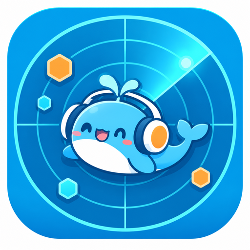

<p align="center">
  
</p>

<h1 align="center">社区雷达 · Community Radar</h1>

<p align="center">
  让机器人自己逛 B 站、抖音、小黑盒：按人格和聊天话题挑内容，看得懂视频与图文，看到有意思的会带图分享。
</p>

<p align="center">
  <a href="CHANGELOG.md">更新日志</a> ·
  <a href="CHANGELOG.md">v0.15 详细说明</a> ·
  <a href="LICENSE">MIT License</a>
</p>

## 这是什么

社区雷达是给 [AstrBot](https://github.com/AstrBotDevs/AstrBot) 用的社区浏览插件。

它不会定时把热榜原样贴一遍，而是让机器人像人一样决定：什么时候逛、逛哪个平台、看什么、要不要说、说给谁听。看到真正有感觉的内容，会带回私聊或群里；没感觉就安静看完。

## 主要能力

- **自主浏览**：在时间区间内随机挑时机，按人格、近期兴趣和平台偏好决定这轮逛哪儿、搜什么。
- **话题驱动**：群聊、私聊里聊到的东西，会记成「自己也想去看看」的待搜话题，下次优先去搜；只记录，不因此插话。
- **真正看懂内容**：B 站字幕、抖音分享页、小黑盒正文与配图；没字幕就抽帧看画面，可选音轨转写。长字幕分段概括，并标注实际覆盖范围。
- **观看记忆**：SQLite 保存看过的内容、摘要、来源、局限和感想；同一内容不重复下载，重复链接优先读记忆。
- **兴趣积累**：从真实内容里提取喜欢、不喜欢、看腻、好奇及依据，随时间衰减，不自动改写基础人格。
- **带图分条分享**：分享时附上封面或画面，并可由模型自己拆成 1~3 条短消息，按间隔逐条发送；发不出去自动退回纯文字。可私聊主人，也可在指定群里顺口说一句。
- **跨插件只读接口**：`radar_explore_api.explore(topic)` 返回标题、简介和链接，不写记忆、不发消息、不点赞评论，供其他插件按话题检索。
- **互动**：B 站、抖音、小黑盒的点赞、评论、回复、发帖；默认试运行，全部有每日上限与最小间隔。
- **扩展玩法**：浏览周记、番剧本地追踪、按问题定向补看、关注 UP 更新候选、白名单通知/私信回复。

详细的 v0.15 命令与边界见 [CHANGELOG.md](CHANGELOG.md)。

## 安装

要求 **AstrBot 4.16 ~ 4.29.x**、**Python 3.10+**。

在 AstrBot 插件管理里选择「从仓库安装」，填入：

```text
https://github.com/arsnyeon/astrbot_plugin_community_radar
```

也可以把仓库放进 `data/plugins/astrbot_plugin_community_radar` 后重载插件。

可选依赖：

| 用途 | 需要 |
|---|---|
| 视频抽帧 | 系统 `ffmpeg` |
| 抖音推荐流 / 点赞评论 | Playwright + Chromium（见 `install_browser.sh`），扫码登录，建议小号 |
| B 站字幕 / 互动 | B 站 Cookie（`bili_cookie`） |
| 小黑盒互动 | 小黑盒 Cookie（`heybox_cookie`） |

只看不互动时，B 站、小黑盒不需要登录；抖音热榜也不需要。

### Windows 桌面运行

原生 Windows 下优先寻找已安装的 Edge，其次 Chrome（常用安装目录、注册表、PATH）。无需 Xvfb，也无需下载 Playwright 的 Chromium 内核；但仍需在 **AstrBot 实际使用的 Python 环境** 安装 `playwright` 包：

```powershell
python -m pip install playwright
```

自动检测失败可设置 `COMMUNITY_RADAR_BROWSER_PATH` 为浏览器完整路径。插件使用自己的 `douyin-profile`，不会读取个人默认浏览器资料；第一次仍须登录。默认尽量隐藏窗口，二维码仍可通过原有登录命令获取。窗口是否短暂出现受浏览器版本影响，不保证完全无界面。

CDP 仅绑定本机；端口被非本插件进程占用时拒绝接管，可用 `COMMUNITY_RADAR_CDP_PORT` 换端口。仅关闭本插件启动的进程，不按浏览器名称批量结束进程。

Windows 上的 Docker/WSL 部署仍走 Linux 路径，不能直接调用 Windows 桌面浏览器。Linux 保留 Chromium + Xvfb 方案。Windows 分支需实机验证登录与播放，不以模拟测试替代平台端到端验证。

## 快速配置

| 配置 | 说明 |
|---|---|
| `admin_uin` | 主人 QQ 号。留空则不会主动推送，写操作全部禁用 |
| `browse.enable` | 打开自主浏览 |
| `browse.platforms` | `all` / `both` / `bili` / `heybox` / `douyin` |
| `browse.interests_mode` | `auto`（自己决定）/ `manual` / `hybrid` |
| `browse.attach_image` | 分享时带封面 |
| `topic.enable` | 从聊天里收集待搜话题 |
| `group_share.enable` | 允许在群里顺口说一句（默认关闭） |
| `share.enable` | 主动分享与每日上限 |
| `bili.dry_run` / `douyin.dry_run` | 试运行，只记录不真操作 |

完整配置项见插件配置页，或 `_conf_schema.json`。

## 常用命令

| 命令 | 作用 |
|---|---|
| `/社区雷达` | 状态、这轮打算逛哪、待搜话题 |
| `/社区雷达 逛` | 现在就去逛（管理员） |
| `/雷达记忆 关键词` | 翻看过的内容记忆 |
| `/雷达兴趣` | 看兴趣积累 |
| `/雷达活动` | 正在挑选 / 分析 / 空闲 |
| `/雷达周记` | 生成浏览周记 |
| `/雷达补看 链接 起 止 问题` | 针对一个问题补看片段 |
| `/看视频 <链接>` | 看懂一条 B 站 / 抖音 / 小黑盒内容 |
| `/刷b站`、`/b站状态` | B 站自主浏览与额度 |
| `/抖音 帮助` | 抖音相关命令 |

## 工作方式

```text
选择平台 / 话题
      ↓
搜索或热门候选
      ↓
取得内容证据（字幕 / 画面 / 正文 / 配图）
      ↓
形成摘要与感想，写入观看记忆
      ↓
决定是否分享、分享给谁、要不要配图
```

找不到可靠内容时，会保留「未确认」标注，不假装看过。

## 边界与安全

- 所有写操作默认**试运行**，只记录不执行；确认行为后再关闭。
- 写操作有每日额度、最小间隔和主人校验；非主人不能触发。
- B 站试运行不消耗真实点赞/评论额度。
- 不绕过会员、地区限制或平台风控；接口失败会明确返回失败。
- 平台接口随时可能变化，失败时保留状态，不视为「已看完」。
- 群聊分享默认关闭，建议先只开私聊观察一段时间。
- 请遵守各平台用户协议，不要用于批量采集、刷量或骚扰。

## 数据与隐私

- 观看记忆、兴趣、计划等保存在插件数据目录的 `radar.sqlite3`（WAL 模式），不上传到第三方。
- Cookie 只保存在本机插件配置中，用于对应平台的登录态。
- 分析内容时会按你的模型配置发送给模型供应商；这是使用模型理解内容的必要步骤。
- 不直接修改其他记忆、日记或生活日程插件的私有数据库；跨插件读取通过 `radar_memory_api` 提供。

## 更新

- [CHANGELOG.md](CHANGELOG.md)：逐版本变更
- [CHANGELOG.md](CHANGELOG.md)：v0.15 的完整命令、配置与边界

## 致谢

观看记忆、兴趣证据、定向补看和「发送结果未知」的处理思路参考了 [chenluQwQ/astrbot_plugin_bilibili_ai_bot](https://github.com/chenluQwQ/astrbot_plugin_bilibili_ai_bot)，并按本插件的三平台结构独立实现。

## License

[MIT](LICENSE)
